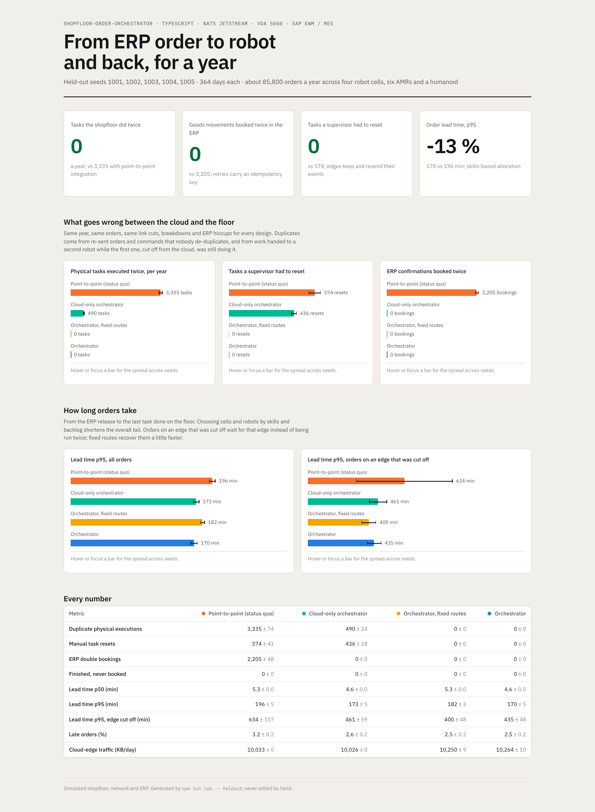
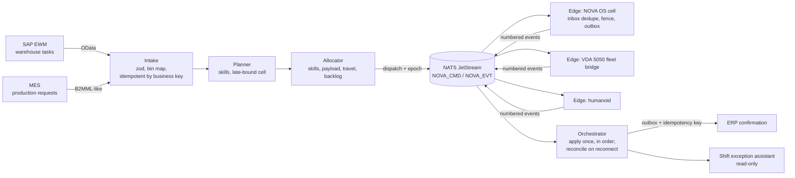

# shopfloor-order-orchestrator

The orchestration layer between enterprise systems and a shopfloor of robots, written in TypeScript.

It takes warehouse tasks from SAP EWM and production orders from the MES, then breaks each order into skill-based tasks. Those tasks go to stationary robot cells, AMRs over VDA 5050, or a humanoid. Results go back to the ERP. The code is built for the hard part: an edge and the cloud that lose each other several times a month, a broker that delivers some messages twice, and an ERP that sometimes times out after it has already booked.



## Results

<!-- lab:begin (generated by npm run lab -- heldout; do not edit) -->
Held-out run: 5 seeds × 364 days, about 85,800 ERP/MES orders each. Mean ± sd across seeds, per simulated year.

| Metric | Status quo: point-to-point integration | Cloud orchestrator, no edge buffering | Orchestrator: capability routing + edge outbox, fencing, reconcile | Ablation: orchestrator on fixed routes |
|---|---:|---:|---:|---:|
| Duplicate physical executions | 3,335 ± 74 | 490 ± 24 | 0 ± 0 | 0 ± 0 |
| Manual task resets | 574 ± 41 | 436 ± 18 | 0 ± 0 | 0 ± 0 |
| ERP double bookings | 2,205 ± 48 | 0 ± 0 | 0 ± 0 | 0 ± 0 |
| Order lead time p95 (min) | 196 ± 5 | 173 ± 5 | 170 ± 5 | 182 ± 3 |
| Lead time p95, orders hit by a cut (min) | 634 ± 317 | 461 ± 59 | 435 ± 48 | 400 ± 48 |
| Late orders (%) | 3.2 ± 0.2 | 2.6 ± 0.2 | 2.5 ± 0.2 | 2.5 ± 0.2 |
| Lead time p50 (min) | 5.3 ± 0.0 | 4.6 ± 0.0 | 4.6 ± 0.0 | 5.3 ± 0.0 |
| Finished but never booked | 0 ± 0 | 0 ± 0 | 0 ± 0 | 0 ± 0 |
| Cloud-edge traffic (KB/day) | 10,033 ± 0 | 10,026 ± 0 | 10,264 ± 10 | 10,250 ± 9 |

Orchestrator vs point-to-point: lead time p95 -13 %, late orders -20 %, duplicate executions -100 %, manual resets -100 %, ERP double bookings -100 %.
<!-- lab:end -->

What the numbers say (held-out seeds):

- **Point-to-point integration does work twice.** The same production order is built twice when the MES re-sends it after a timeout. A command is retried with a fresh id after its acknowledgement was lost. A supervisor resets a task whose result the edge sent while it was cut off. Each of these runs a physical task a second time, and each retried confirmation without an idempotency key is a second goods movement in the ERP: about 3,300 duplicate executions and 2,200 double bookings a year.
- **Idempotency in the cloud alone helps, but not all the way.** The cloud-only orchestrator removes the ERP double bookings and cuts duplicate executions by about 85 %. About 490 duplicates and 440 manual resets a year remain. It hands work from a silent edge to another robot while the first robot finishes it offline, and its edges drop events while the link is down, so tasks hang until somebody resets them.
- **The edge outbox, fences and reconcile together bring all three counts to zero.** The edge keeps every event until the cloud acknowledges it. Commands carry an epoch, so a stale copy is refused. Accepted work stays pinned to its edge, and the cloud checks with the edge after a reconnect before moving anything. Pinning does not cost time on the orders a cut edge holds: their p95 is 435 min, against 461 for cloud-only and 634 for point-to-point.
- **Skill-based allocation shortens the overall tail, not the cut recovery.** Choosing cells and robots by skills, payload, travel and backlog brings the p95 to 170 min, against 182 on fixed routes, and the median to 4.6 min, against 5.3. On orders hit by a cut, the fixed-route ablation is faster (400 vs 435 min). The gap is within one standard deviation across seeds (±48), so I don't claim a cause.
- **The edge protocol costs about 2 % more cloud-edge traffic** (10,264 vs 10,033 KB/day), for acknowledgements, resends and reconcile messages.

The first held-out run was stopped after 17 of 20 runs because of two bugs in how a supervisor reset is handled. They affected only the baselines; the orchestrator lines were identical before and after the fix. All 20 runs were then repeated. [ADR 0005](docs/adr/0005-late-done-after-reset.md) has the details, and `lab/heldout.lock` records the reason for the re-run.

## What is in it



| Part | Where | What it does |
|---|---|---|
| Domain | `src/domain` | Orders, tasks and resources. Resources declare skills with payload limits and speed factors, so a new form factor plugs in by declaring what it can do. The order and task lifecycles are explicit state machines. |
| Intake | `src/intake` | EWM warehouse tasks (fields modelled on the EWM warehouse-task OData API) and MES production requests (ISA-95/B2MML-style), validated with zod. Storage bins map to locations. The business key is the order id, so a re-sent order is recognised. |
| Planner | `src/planner` | Transfer → one transport. Production → supply, process, output. The cell is chosen only when the material is released (late binding). |
| Allocator | `src/dispatch` | Reserves a cell by skills and backlog. Sends a transport to the mobile resource that gets there first. Queue depth per resource is what an edge keeps working through while offline. |
| Edge agent | `src/sync/edge.ts` | Runs next to the robots. An inbox de-duplicates commands, a fence refuses older epochs, and an outbox of gap-free numbered events lives in a durable store (`node:sqlite`). It also handles reconcile, revoke and resource-down. |
| Orchestrator | `src/sync/cloud.ts` | Applies each edge's events once and in order, raises the epoch on reassignment, keeps accepted work pinned to a silent edge, reconciles on reconnect and confirms to the ERP through an outbox. |
| VDA 5050 | `src/vda5050` | Turns a transport task into a VDA 5050 v2 order (pick → edge → drop, HARD blocking, even and odd sequence ids). Reads vehicle states back as started, done or failed. MANUAL mode or a FATAL error hands the work back. |
| Transport | `src/transport/nats.ts` | JetStream streams, durable consumers per edge and for the cloud, and a message id per command or event for broker-side de-duplication. Heartbeats go over plain NATS. |
| Service | `src/service` | Fastify API with roles, Prometheus metrics, OpenTelemetry spans exported over OTLP, and pino logs. |
| Assistant | `src/agent` | Tells a shift lead why an order is stuck. Code builds the facts. A model may phrase them, but any number or id that is not in the facts sends the answer back to the template. |
| Lab | `src/lab` | A discrete-event year per seed that runs the same edge agent and orchestrator code over a simulated network. The plant truth referees what really happened. |

### API

All routes need `Authorization: Bearer <token>`. Tokens and roles come from `API_TOKENS`.

| Method | Path | Role |
|---|---|---|
| POST | `/v1/intake/ewm`, `/v1/intake/mes` | erp. Returns 202 with the order id and `duplicate: true` for a re-send. |
| GET | `/v1/orders`, `/v1/orders/:id` | viewer or supervisor |
| GET | `/v1/orders/:id/explanation`, `/v1/exceptions` | viewer or supervisor |
| GET | `/v1/resources`, `/v1/edges` | viewer or supervisor |
| GET | `/metrics`, `/healthz` | open; the cluster scrapes them |

## How the lab works

- **A year per seed.** 52 weeks of weekdays, three shifts, about 110 production orders (40 % released in shift-start bursts) and 220 warehouse tasks a day.
- **The floor.** Four robot cells with different skill sets, six AMRs behind one VDA 5050 bridge, and a humanoid that carries ≤ 12 kg and assembles slowly.
- **Faults, drawn from the seed:**

  | Fault | Rate | Duration |
  |---|---|---|
  | Edge link cut | ~3 per edge per month | median 4 min, up to 60 |
  | Cloud outage | ~1 per month | 5–25 min |
  | AMR breakdown | 1 per AMR per month | 30–240 min |
  | ERP outage | 2 per month | 10–60 min |

  On top of that:
  - 1.5 % of ERP/MES orders are sent twice;
  - 0.3 % of messages are lost and 0.3 % duplicated;
  - 1 % of ERP calls book the movement but lose the response;
  - 1.5 % of process steps and 0.3 % of transports fail.
- **The same code runs in the lab and in the service.** The lab uses the same `EdgeAgent` and `Orchestrator` code as the service, over a simulated network instead of NATS.
- **The plant truth referees.** `PlantTruth` counts real executions per business task, and `SimErp` counts bookings per business order.
- **Designs.** All four run the same world:

  | Design | Routing | Commands | Edge | Silent edge | ERP |
  |---|---|---|---|---|---|
  | `point-to-point` (status quo) | fixed | fresh id per retry, no epochs | no dedupe, no outbox | wait, then manual reset | retries without key |
  | `cloud-only` | skills | stable ids, epochs | dedupe and fence, no outbox | reassign after 2 min | idempotency key |
  | `orchestrator` | skills | stable ids, epochs | dedupe, fence, durable outbox | pinned, reconcile on reconnect | idempotency key |
  | `orchestrator-static` (ablation) | fixed | as `orchestrator` | as `orchestrator` | as `orchestrator` | as `orchestrator` |

- **Seeds.** Dev seeds 1–3 are for tuning. Held-out seeds 1001–1005 ran once; `lab/heldout.lock` holds the hash of their results. CI checks the README block, `reports/heldout.*` and the dashboard data against it, and that the held-out run refuses a second go.

## Limits

- Everything in the lab is simulated: orders, robots, network, ERP. The fault rates are assumptions, not measurements from a plant.
- NOVA OS itself is not called. A cell edge here runs a timed driver where a real one would start a NOVA program. The VDA 5050 bridge is implemented and tested against message fixtures, not a real fleet; MQTT is not wired in.
- SAP is not called. The EWM and MES payloads are modelled on the public API shapes, and the confirmation is an HTTP call with an idempotency key behind a configurable base URL.
- The cell is reserved when material is released. If that cell fails later, the process waits for it instead of re-routing the material.
- One active orchestrator per shopfloor (single writer). High availability is a standby that takes over the durable consumer, not active-active.
- An edge must keep its store on disk (`SqliteEdgeStore`). A memory store restarts its event numbering, which JetStream and the orchestrator would then treat as duplicates.

## Run it

You need Node.js 22.13 or later.

```bash
npm ci
npm test                         # unit and scenario tests
NATS_SERVER_BIN=/path/to/nats-server npm run test:nats   # integration over JetStream
npm run lab -- smoke             # 21 days, one seed: orchestrator must have no duplicates, double bookings or resets
npm run lab -- dev               # dev seeds -> reports/dev.*
npm run lab -- check             # README, reports and dashboard match the held-out lock
docker compose -f deploy/docker-compose.yml up --build   # NATS, orchestrator, seven edges
cd dashboard && npm ci && npm run dev
```

- With the stack up, send a warehouse task:

  ```bash
  curl -X POST localhost:8080/v1/intake/ewm -H 'Authorization: Bearer erp-dev' -H 'Content-Type: application/json' \
    -d '{"EWMWarehouse":"1710","WarehouseTask":"100000812","Product":"HU-1","SourceStorageBin":"SM-01-03-B","DestinationStorageBin":"LINE-C2-IN","TargetQuantityInBaseUnit":1,"NetWeight":90}'
  ```

- `kubectl apply -k deploy/k8s/overlays/prod` deploys a three-node NATS cluster with JetStream and the orchestrator. It runs restricted Pod Security, a read-only root filesystem and a NetworkPolicy, and exports traces over OTLP.

## Layout

```
src/domain      orders, tasks, resources, lifecycle, reference shopfloor
src/intake      EWM and MES adapters, confirmations
src/planner     recipes, decomposition
src/dispatch    cell reservation, allocation
src/sync        protocol, edge agent and store, orchestrator
src/vda5050     VDA 5050 types, translation, fleet driver
src/transport   NATS JetStream link
src/erp         confirmation outbox, HTTP ERP port
src/agent       shift exception assistant
src/service     HTTP API, metrics, tracing, entry points
src/lab         simulated year, designs, report, CLI
test/           vitest; test/nats needs a nats-server
dashboard/      React + Framer Motion results dashboard
deploy/         Kubernetes (kustomize) and docker compose
docs/adr/       decisions
```

MIT licence.
